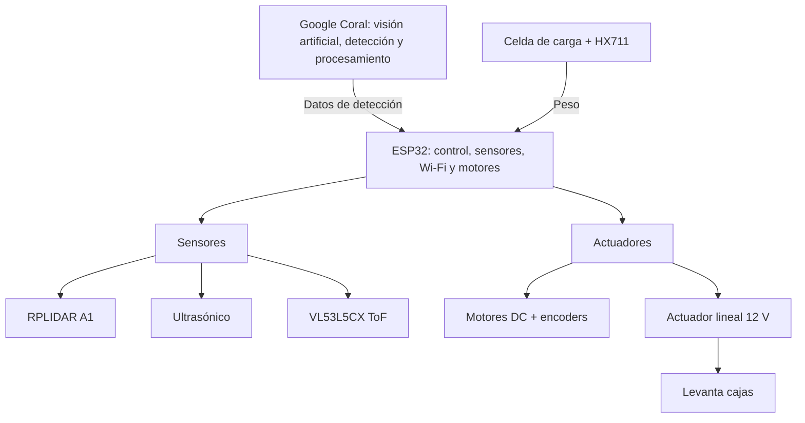
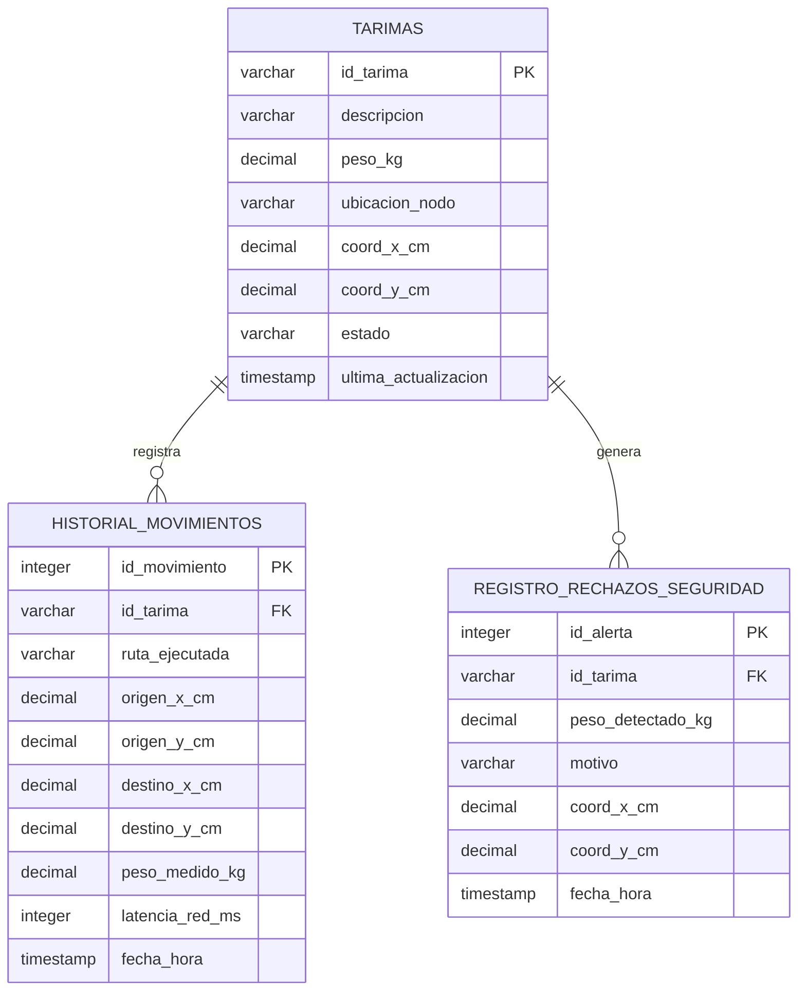

# KOLEO — Organización automática en almacenes

**Materia:** Implementación de Internet de las Cosas (Gpo. 501)  
**Institución:** Tecnológico de Monterrey, Campus Guadalajara  
**Fecha de presentación:** 21 de octubre de 2026

**Integrantes:**
- Miranda Henry
- Álvaro Alcaraz
- Osvaldo Sierra
- Elías Tamez
- Leonardo Alfonzo

> **Nota de conversión:** Este documento reorganiza en Markdown el contenido de las 32 diapositivas originales. Conserva sus cifras, nombres de componentes, fragmentos de código y estado reportado del proyecto. Los fragmentos que eran parciales en la presentación se mantienen como tales; **no constituyen necesariamente programas ejecutables completos**. Las imágenes técnicas originales se guardan en la carpeta `assets/`.

## Contenido

1. [Descripción general](#1-descripción-general)
2. [Objetivos y métricas](#2-objetivos-y-métricas)
3. [Sensores, actuadores y arquitectura](#3-sensores-actuadores-y-arquitectura)
4. [Indicadores métricos](#4-indicadores-métricos)
5. [Equipo y responsabilidades](#5-equipo-y-responsabilidades)
6. [Diseño CAD](#6-diseño-cad)
7. [Conexiones de hardware](#7-conexiones-de-hardware)
8. [Avances y pendientes](#8-avances-y-pendientes)
9. [Código del ESP32](#9-código-del-esp32)
10. [Código de la Raspberry Pi](#10-código-de-la-raspberry-pi)
11. [Base de datos](#11-base-de-datos)
12. [Interfaz de usuario](#12-interfaz-de-usuario)

---

## 1. Descripción general

*Diapositiva 2.*

### Problemática a resolver

Muchos almacenes pierden tiempo y espacio porque siguen moviendo las tarimas a mano y no tienen cómo rastrearlas al instante. Al no saber con certeza dónde está cada carga, cuánto pesa o qué contiene, la base de datos casi nunca coincide con lo que hay físicamente en el piso. Esto provoca retrasos, errores al enviar pedidos y evita que la empresa pueda usar datos reales para organizar mejores rutas y aprovechar todo el espacio disponible.

### Nombre y área

- **Nombre:** KOLEO.
- **Origen del nombre:** referencia a los escarabajos blindados que se deslizan bajo cargas pesadas.
- **Área de aplicación:** sectores e industrias; zonas específicas dentro del almacén.

## 2. Objetivos y métricas

*Diapositiva 3.*

| Área | Objetivo | Meta |
|---|---|---|
| Mecánica | Diseñar un sistema de elevación con actuador lineal que levante hasta 10 kg. | **10 kg en menos de 15 s** |
| Mapeo y navegación | Que el robot llegue de un punto a otro de la bodega de forma autónoma. | **Menos de 10 cm** de error al llegar |
| Software e IoT | Que el robot envíe sus movimientos para actualizar la posición de cada tarima en la base de datos. | **Menos de 2 s** desde que deja la tarima hasta que la base se actualiza |

## 3. Sensores, actuadores y arquitectura

*Diapositivas 4 y 5.*

### Componentes ilustrados

| Núm. | Componente |
|---|---|
| 1 | Cámara RGB (Raspberry Pi Camera Module 3) |
| 2 | RPLIDAR A1 |
| 3 | Sensor ultrasónico |
| 4 | HX711 + Load Cell (Adafruit) |
| 5 | Sensor ToF — VL53L5CX |
| 6 | ESP32 Wi-Fi |
| 7 | Actuador lineal eléctrico de 12 V |
| 8 | Motores DC con reductora y encoder |


### Diagrama de aplicación

La presentación organiza la arquitectura alrededor del **ESP32**, encargado del control del robot, lectura de sensores, comunicación Wi-Fi y control de motores. Recibe datos de detección de un módulo **Google Coral** (IA y visión artificial, detección de objetos y personas, procesamiento de cámara) y datos de peso de la **celda de carga + HX711**. Se conecta con sensores (RPLIDAR A1, ultrasonido, VL53L5CX ToF) y actuadores (motores DC con encoders y actuador lineal de 12 V).



> El diagrama Mermaid anterior representa los bloques funcionales descritos. Para revisar la **disposición y las conexiones gráficas exactas de la diapositiva**, consultar la imagen original:


## 4. Indicadores métricos

*Diapositiva 6. Área: gestión de almacén.*

- Ocupación y disponibilidad en tiempo real.
- Posición actual del robot.
- Tiempo de ciclo por tarima.
- Peso de carga.
- Precisión de posicionamiento.
- Eficiencia de ruta.
- Distancia mínima a obstáculos.
- Alertas e incidencias.

## 5. Equipo y responsabilidades

*Diapositiva 7.*

| Integrante | Responsabilidad |
|---|---|
| Leo (Leonardo Alfonzo) | Programación de sensores |
| Álvaro (Alcaraz) | Mecánica del carro |
| Osvaldo (Sierra) | Interfaz |
| Elías (Tamez) | Programación de sensores |
| Miranda (Henry) | Mecánica del carro |

## 6. Diseño CAD

*Diapositivas 8 a 10.*

La presentación incluye tres vistas del diseño CAD del robot, con la disposición de la plataforma para tarimas y de los componentes integrados. Entre las etiquetas visibles aparecen **RPLIDAR A1 (navegación)**, **cámara RGB + sensor ToF**, **ultrasónico (seguridad)**, **Raspberry Pi 5**, **ESP32 + puentes H**, **batería Li-P**, **actuador/plataforma** y **motor DC + rueda**.

### Vista isométrica


### Vista de componentes


### Vista superior


## 7. Conexiones de hardware

### 7.1 ESP32 DevKit V1

*Diapositiva 11. Lógica de 3.3 V; conexión Wi-Fi a la base de datos.*

**Sensores**

| Dispositivo | Señal | Conexión ESP32 |
|---|---|---|
| Celda de carga + HX711 | DT | GPIO 4 |
| Celda de carga + HX711 | SCK | GPIO 5 |
| Encoder izquierdo (canal A) | Salida | GPIO 34 |
| Encoder derecho (canal A) | Salida | GPIO 35 |
| VL53L5CX ToF (I²C) | SDA | GPIO 21 |
| VL53L5CX ToF (I²C) | SCL | GPIO 22 |
| Ultrasónico HC-SR04 | TRIG | GPIO 18 |
| Ultrasónico HC-SR04 | ECHO | GPIO 19 |

**Precaución indicada:** divisor de tensión de **5 V a 3.3 V** en la señal `ECHO` del HC-SR04.

**Actuadores y comunicación**

| Dispositivo | Señal | Conexión |
|---|---|---|
| Actuador lineal 12 V — BTS7960 | RPWM (subir) | GPIO 25 |
| Actuador lineal 12 V — BTS7960 | LPWM (bajar) | GPIO 26 |
| Motor izquierdo — puente H | PWM / IN1 / IN2 | GPIO 32 / 33 / 27 |
| Motor derecho — puente H | PWM / IN3 / IN4 | GPIO 14 / 12 / 13 |
| Raspberry Pi 5 — UART | TX (GPIO14) de Pi → RX2 de ESP32 | GPIO 16 (ESP32) |
| Raspberry Pi 5 — UART | RX (GPIO15) de Pi ← TX2 de ESP32 | GPIO 17 (ESP32) |

- **Tracción:** diferencial.
- **Alimentación:** 12 V para puentes H y actuador; convertidor *buck* 5 V / 5 A para Raspberry Pi 5; LM2596 para ESP32 y sensores; tierra común (`GND`).

### 7.2 Raspberry Pi 5

*Diapositiva 12. Raspberry Pi 5 de 8 GB y lógica de 3.3 V.*

| Función | Componente/conexión | Detalle |
|---|---|---|
| Lectura del identificador de tarima | Camera Module 3 | Puerto CSI; cable de 22 a 15 pines; lectura del QR de cada tarima |
| Navegación | RPLIDAR A1 | Puerto USB; datos y alimentación de 5 V por el mismo cable |
| UART hacia ESP32 | Pin 8, TXD GPIO14 | → RX2 GPIO 16 en ESP32 |
| UART desde ESP32 | Pin 10, RXD GPIO15 | ← TX2 GPIO 17 en ESP32 |
| Tierra común | Pin 6, GND | ↔ GND en ESP32 |
| Alimentación | USB-C | 5 V / 5 A desde convertidor *buck* |

- **Comunicación UART:** 115200 baudios, ambos dispositivos a 3.3 V, sin convertidor de nivel.
- **Alimentación:** con menos de 5 A, la Raspberry Pi limita la corriente de los puertos USB.
- **Configuración:** activar el puerto serie en `raspi-config`; la presentación indica lectura de cámara con `Picamera2`.

## 8. Avances y pendientes

### 8.1 Trabajo realizado

*Diapositiva 13. Avances y logros por área hasta la semana 3.*

| Área | Trabajo reportado |
|---|---|
| Mecánica — diseño CAD | CAD 3D del chasis; mecanismo de elevación; vistas con ubicación de cada componente |
| Hardware y electrónica — componentes y conexiones | Lista completa de potencia y regulación; pinout del ESP32 y de la Raspberry Pi 5; diagrama de alimentación |
| Control y navegación — rutas y visión | Planeador A* que resuelve las tres rutas de validación; lectura del QR de cada tarima; protocolo UART con el ESP32: `LIFT`, `MOVE`, `STOP` y `DROP` |
| Software e IoT — firmware y datos | Firmware del ESP32 con pesaje y límite de 10 kg; envío HTTP de JSON a la Web API; esquema SQL de tres tablas, demostración y diseño del tablero |

### 8.2 Trabajo a realizar

*Diapositiva 14.*

**Tareas pendientes — construcción**

- Ensamblar el chasis y el mecanismo de elevación.
- Instalar tracción, celda de carga y sensores.
- Programar la Web API.
- Conectar la Raspberry Pi y el ESP32 por UART.

**Mejoras planificadas — ajustes al código**

- Usar los encoders para avanzar por distancia.
- Freno por obstáculo continuo.
- Bloquear la elevación si falla la báscula.
- Integrar el RPLIDAR al mapa y la cámara con `Picamera2`.

**Próximos pasos — validación**

- Prueba de banco con 10 kg.
- Prueba de transporte de tres minutos.
- Tres rutas autónomas.
- Latencia de la base menor a dos segundos.

---

## 9. Código del ESP32

*Diapositivas 15 a 20. Lenguaje: C++.*

La sección original incluye: librerías y arranque; recepción de órdenes; peso y encoders; control de motores; depósito y envío de datos.

### 9.1 Librerías y arranque (`setup`)

*Diapositiva 16. Fragmento de dependencias e inicialización.*

```cpp
#include <WiFi.h>
#include <HTTPClient.h>
#include "HX711.h"

void setup() {
    Serial.begin(115200);
    Serial2.begin(115200, SERIAL_8N1, 16, 17);

    // Configuración de pines
    pinMode(PIN_ACT_SUBIR, OUTPUT);
    pinMode(PIN_ACT_BAJAR, OUTPUT);
    // ... otros pines del firmware

    // Interrupciones para encoders
    pinMode(PIN_ENC_L, INPUT_PULLUP);
    pinMode(PIN_ENC_R, INPUT_PULLUP);
    attachInterrupt(digitalPinToInterrupt(PIN_ENC_L),
                    isrEncoderIzq, RISING);
    attachInterrupt(digitalPinToInterrupt(PIN_ENC_R),
                    isrEncoderDer, RISING);

    // Inicialización del HX711
    balanza.begin(PIN_HX711_DT, PIN_HX711_SCK);
    balanza.set_scale(FACTOR_CALIBRACION);
    balanza.tare();

    // Conexión a Wi-Fi
    WiFi.begin(WIFI_SSID, WIFI_PASSWORD);
}
```

**Explicación incluida en la presentación:**

1. `WiFi.h` conecta a la red, `HTTPClient.h` realiza el POST y `HX711.h` lee la celda de carga.
2. `Serial` abre el monitor y `Serial2` comunica con la Raspberry Pi.
3. Prepara pines de actuador y motores y activa las interrupciones de encoders.
4. Inicia el HX711, configura calibración y realiza la tara.
5. Intenta establecer conexión Wi-Fi.

### 9.2 Recibir órdenes (`loop`)

*Diapositiva 17.*

```cpp
void loop() {
    if (Serial2.available()) {
        String comando = Serial2.readStringUntil('\n');
        comando.trim();

        if (comando.startsWith("LIFT:")) {
            idTarimaActual = comando.substring(5);
            bool exito = levantarTarima(idTarimaActual);

            Serial2.println(exito ?
                "ACK:LIFT_OK" : "ERR:OVERWEIGHT");
        }
        else if (comando.startsWith("MOVE:")) {
            int p1 = comando.indexOf(':', 5);
            int velL = comando.substring(5, p1).toInt();
            int velR = comando.substring(p1 + 1).toInt();

            moverMotores(velL, velR);
        }
        else if (comando == "STOP") {
            detenerMotores();
        }
    }
}
```

La comunicación llega por `Serial2` como líneas de texto terminadas en `\n`. Las órdenes indicadas son `LIFT`, `MOVE`, `STOP` y `DROP`; el **fragmento visible** muestra las ramas `LIFT`, `MOVE` y `STOP`. La elevación responde con confirmación `ACK:LIFT_OK` o error `ERR:OVERWEIGHT`.

### 9.3 Peso y encoders

*Diapositiva 18.*

```cpp
// Peso: celda de carga con HX711
float medirPesoKg() {
    if (balanza.is_ready()) {
        float peso = balanza.get_units(5);
        return (peso < 0.0) ? 0.0 : peso;
    }
    return 0.0;
}

// Encoders: contadores de pulsos
volatile long pulsosEncoderIzq = 0;
volatile long pulsosEncoderDer = 0;

void IRAM_ATTR isrEncoderIzq() {
    pulsosEncoderIzq++;
}

void IRAM_ATTR isrEncoderDer() {
    pulsosEncoderDer++;
}

// Se activan desde setup() con RISING
```

**Explicación:** `is_ready()` comprueba disponibilidad del HX711; `get_units(5)` promedia cinco lecturas; un peso negativo o una lectura no disponible devuelve `0.0` kg; cada interrupción ascendente (`RISING`) suma un pulso al contador de la rueda correspondiente.

### 9.4 Control de motores

*Diapositiva 19.*

```cpp
void moverMotores(int pwmIzq, int pwmDer) {
    if (medirDistanciaUltrasonicoCm() <
        DISTANCIA_PARO_CM &&
        (pwmIzq > 0 || pwmDer > 0)) {
        detenerMotores();
        Serial2.println("ERR:OBSTACULO_CERCANO");
        return;
    }

    digitalWrite(PIN_MOT_L_IN1, pwmIzq >= 0 ? HIGH : LOW);
    digitalWrite(PIN_MOT_L_IN2, pwmIzq >= 0 ? LOW : HIGH);
    analogWrite(PIN_MOT_L_PWM, abs(pwmIzq));

    digitalWrite(PIN_MOT_R_IN3, pwmDer >= 0 ? HIGH : LOW);
    digitalWrite(PIN_MOT_R_IN4, pwmDer >= 0 ? LOW : HIGH);
    analogWrite(PIN_MOT_R_PWM, abs(pwmDer));
}

void detenerMotores() {
    analogWrite(PIN_MOT_L_PWM, 0);
    analogWrite(PIN_MOT_R_PWM, 0);
}
```

**Explicación:** la función recibe valores PWM para ambas ruedas; detiene el movimiento y notifica a la Raspberry Pi si el ultrasónico detecta un obstáculo a menos de `DISTANCIA_PARO_CM` mientras se ordena avance. El signo del PWM indica el sentido del giro, su valor absoluto determina la intensidad y detener ambos motores equivale a fijar PWM en cero.

### 9.5 Depositar tarima y enviar datos

*Diapositiva 20.*

```cpp
void depositarTarima(String idTarima,
                     float nuevoX, float nuevoY) {
    Serial.println("Descendiendo actuador...");
    analogWrite(PIN_ACT_SUBIR, 0);
    analogWrite(PIN_ACT_BAJAR, 255);
    delay(TIEMPO_ELEV_MS);
    analogWrite(PIN_ACT_BAJAR, 0);

    coordX_cm = nuevoX;
    coordY_cm = nuevoY;

    float pesoFinal = medirPesoKg();
    enviarActualizacionBD(idTarima, pesoFinal,
        coordX_cm, coordY_cm, "EN_PISO");
}
```

**Fragmento adicional de envío HTTP POST (presentado separado del contexto de una función):**

```cpp
// Envío a la base de datos
if (WiFi.status() == WL_CONNECTED) {
    HTTPClient http;
    http.begin(SERVER_URL);
    http.addHeader("Content-Type", "application/json");
    // payload: JSON armado previamente
    int resultado = http.POST(payload);
    http.end();
}
```

**Secuencia:** se apaga la salida de subida, se activa la de bajada durante `TIEMPO_ELEV_MS`, se guardan las coordenadas de `DROP`, se mide el peso y se reporta el estado `EN_PISO`. El cuerpo JSON contiene los campos `id_tarima`, `peso_kg`, `coord_x_cm`, `coord_y_cm` y `estado`.

---

## 10. Código de la Raspberry Pi

*Diapositivas 21 a 25. Lenguaje: Python.*

La sección original comprende configuración y mapa, lectura del QR, planeación de ruta A* y ejecución de la misión.

### 10.1 Configuración y mapa

*Diapositiva 22.*

```python
import heapq
import time
import serial
import cv2

# Mapa del almacén: celdas de 30 x 30 cm
# 0 = pasillo libre, 1 = estantería / obstáculo
MAPA_ALMACEN = [
    [0, 0, 0, 1, 0, 0],
    [0, 1, 0, 1, 0, 0],
    [0, 1, 0, 0, 0, 1],
    [0, 0, 0, 1, 0, 0],
    [1, 1, 0, 0, 0, 0]
]

# Las 3 rutas oficiales de validación (Hito 2)
RUTAS_VALIDACION = {
    "RUTA_1": {"inicio": (0, 0), "fin": (4, 5),
               "tarima_default": "TAR-101"},
    "RUTA_2": {"inicio": (0, 2), "fin": (3, 4),
               "tarima_default": "TAR-102"},
    "RUTA_3": {"inicio": (4, 2), "fin": (0, 5),
               "tarima_default": "TAR-103"},
}
```

- `heapq`: cola de prioridad para A*.
- `time`: pausas y ventanas de tiempo.
- `serial`: comunicación con ESP32.
- `cv2`: lectura de cámara.
- **Mapa:** cuadrícula de 5 filas × 6 columnas; cada celda representa 30 × 30 cm; `0` es pasillo libre y `1` es obstáculo o estantería.
- **Rutas:** tres trayectos de validación para el Hito 2, con inicio, destino y tarima predeterminada.

### 10.2 Lectura del QR

*Diapositiva 23.*

```python
def leer_qr_tarima(id_respaldo="TAR-101"):
    cap = cv2.VideoCapture(0)
    detector = cv2.QRCodeDetector()
    t_inicio = time.time()

    while time.time() - t_inicio < 2.5:
        ret, frame = cap.read()
        if not ret:
            break
        datos, _, _ = detector.detectAndDecode(frame)
        if datos:
            cap.release()
            print(f"[CÁMARA RGB] Tarima: {datos}")
            return datos

    cap.release()
    # Sin QR: usa el ID asignado a la ruta
    return id_respaldo
```

La rutina abre la cámara con OpenCV, intenta detectar un código QR durante **2.5 segundos** y, si no consigue leerlo, devuelve el ID asignado por defecto a la ruta.

### 10.3 Planeación de ruta A*

*Diapositiva 24.*

```python
class PlanificadorAStar:
    @staticmethod
    def heuristica(a, b):
        return abs(a[0] - b[0]) + abs(a[1] - b[1])

    @classmethod
    def calcular_ruta(cls, mapa, inicio, meta):
        filas, cols = len(mapa), len(mapa[0])
        frontera = [(0, inicio)]
        vino_de = {inicio: None}
        costo_g = {inicio: 0}

        while frontera:
            _, actual = heapq.heappop(frontera)
            if actual == meta:
                break

            for df, dc in [(-1, 0), (1, 0), (0, -1), (0, 1)]:
                vecino = (actual[0] + df, actual[1] + dc)
                if 0 <= vecino[0] < filas and 0 <= vecino[1] < cols:
                    if mapa[vecino[0]][vecino[1]] == 1:
                        continue  # obstáculo
                    nuevo_costo = costo_g[actual] + 1
                    if vecino not in costo_g or nuevo_costo < costo_g[vecino]:
                        costo_g[vecino] = nuevo_costo
                        prioridad = nuevo_costo + cls.heuristica(vecino, meta)
                        heapq.heappush(frontera, (prioridad, vecino))
                        vino_de[vecino] = actual

        if meta not in vino_de:
            return []

        ruta, paso = [], meta
        while paso is not None:
            ruta.append(paso)
            paso = vino_de[paso]
        ruta.reverse()
        return ruta
```

**Funcionamiento explicado en la presentación:**

1. **Heurística:** distancia Manhattan para estimar las celdas faltantes.
2. **Cola de prioridad:** `heapq` explora primero las celdas con menor costo estimado.
3. **Vecinos:** arriba, abajo, izquierda y derecha.
4. **Costo:** registra y actualiza la mejor ruta encontrada hacia cada celda.
5. **Reconstrucción:** recorre `vino_de` desde la meta al inicio e invierte el resultado.

### 10.4 Ejecutar la misión

*Diapositiva 25. Ciclo completo ilustrado.*

```python
def ejecutar_mision(nombre_ruta, puerto_serial=None):
    config = RUTAS_VALIDACION[nombre_ruta]
    inicio, meta = config["inicio"], config["fin"]

    # 1. Identificar la tarima
    id_tarima = leer_qr_tarima(config["tarima_default"])

    # 2. Calcular la ruta con A*
    ruta = PlanificadorAStar.calcular_ruta(
        MAPA_ALMACEN, inicio, meta)

    # 3. Levantar y pesar la tarima
    if puerto_serial:
        puerto_serial.write(f"LIFT:{id_tarima}\n".encode())
        respuesta = puerto_serial.readline().decode().strip()
        if respuesta == "ERR:OVERWEIGHT":
            return  # excede 10 kg: se cancela

    # 4. Recorrer la ruta (cada celda = 30 cm)
    for paso in ruta[1:]:
        if puerto_serial:
            puerto_serial.write(b"MOVE:180:180\n")
            time.sleep(0.8)
            puerto_serial.write(b"STOP\n")

    # 5. Depositar y actualizar la base de datos
    dest_x, dest_y = meta[1] * 30.0, meta[0] * 30.0
    if puerto_serial:
        puerto_serial.write(
            f"DROP:{id_tarima}:{dest_x}:{dest_y}\n".encode())

if __name__ == "__main__":
    ejecutar_mision("RUTA_1", puerto_serial=None)
    # ... igual con RUTA_2 y RUTA_3
```

**Etapas:** leer identificador QR, planear A*, ordenar levantamiento al ESP32, cancelar por sobrepeso, enviar comandos `MOVE` y `STOP` por cada celda y, al llegar, enviar `DROP` con la identificación y coordenadas de destino. La línea de ejecución principal se muestra con `puerto_serial=None`, tal como aparece en la diapositiva.

---

## 11. Base de datos

*Diapositivas 26 a 30. Tecnología indicada: Python + SQLite; modelo `koleo_almacen`.*

### 11.1 Modelo entidad-relación

*Diapositiva 27.*

**Tabla `tarimas` — estado actual de cada tarima**

| Campo | Tipo | Clave |
|---|---|---|
| `id_tarima` | `VARCHAR(32)` | PK |
| `descripcion` | `VARCHAR(100)` | |
| `peso_kg` | `DECIMAL(5,2)` | |
| `ubicacion_nodo` | `VARCHAR(16)` | |
| `coord_x_cm` | `DECIMAL(6,2)` | |
| `coord_y_cm` | `DECIMAL(6,2)` | |
| `estado` | `VARCHAR(20)` | |
| `ultima_actualizacion` | `TIMESTAMP` | |

**Tabla `historial_movimientos` — un registro por cada traslado**

| Campo | Tipo | Clave |
|---|---|---|
| `id_movimiento` | `INTEGER` | PK |
| `id_tarima` | `VARCHAR(32)` | FK |
| `ruta_ejecutada` | `VARCHAR(32)` | |
| `origen_x_cm`, `origen_y_cm` | `DECIMAL(6,2)` | |
| `destino_x_cm`, `destino_y_cm` | `DECIMAL(6,2)` | |
| `peso_medido_kg` | `DECIMAL(5,2)` | |
| `latencia_red_ms` | `INTEGER` | |
| `fecha_hora` | `TIMESTAMP` | |

**Tabla `registro_rechazos_seguridad` — cargas rechazadas por pasar de 10 kg**

| Campo | Tipo | Clave |
|---|---|---|
| `id_alerta` | `INTEGER` | PK |
| `id_tarima` | `VARCHAR(32)` | FK |
| `peso_detectado_kg` | `DECIMAL(5,2)` | |
| `motivo` | `VARCHAR(100)` | |
| `coord_x_cm`, `coord_y_cm` | `DECIMAL(6,2)` | |
| `fecha_hora` | `TIMESTAMP` | |

La relación mostrada es **una tarima a muchos movimientos (1:N)** y **una tarima a muchos rechazos de seguridad (1:N)**. El ESP32 actualiza `tarimas`, cada traslado añade una fila a `historial_movimientos` y cada carga de más de 10 kg genera un registro en `registro_rechazos_seguridad`.




### 11.2 Crear las tablas (`inicializar_bd`)

*Diapositiva 28. Código parcial tal como aparece en la presentación; las elipsis indican partes no mostradas.*

```python
import sqlite3
import time
from datetime import datetime

def inicializar_bd():
    conn = sqlite3.connect("koleo_almacen.db")
    cursor = conn.cursor()
    cursor.executescript("""
        DROP TABLE IF EXISTS tarimas;
        -- (igual con las otras dos tablas)
        CREATE TABLE tarimas (
            id_tarima TEXT PRIMARY KEY,
            descripcion TEXT, peso_kg REAL,
            coord_x_cm REAL, coord_y_cm REAL,
            estado TEXT, ultima_actualizacion TEXT);
        -- + historial_movimientos
        -- + registro_rechazos_seguridad
        INSERT INTO tarimas VALUES
        ('TAR-101', 'Lote Electrónica A', 8.45, ...),
        ('TAR-102', 'Baterías (Sobrepeso)', 11.80, ...),
        ('TAR-103', 'Sensores Ópticos C', 6.20, ...);
    """)
    conn.commit()
    return conn
```

**Resumen de la diapositiva:** abre o crea `koleo_almacen.db`; elimina tablas para reiniciar la demostración; define tres tablas (`tarimas`, `historial_movimientos`, `registro_rechazos_seguridad`); e inserta tres tarimas de prueba.

| Tarima | Descripción | Peso de ejemplo |
|---|---|---:|
| TAR-101 | Lote Electrónica A | 8.45 kg |
| TAR-102 | Baterías (Sobrepeso) | 11.80 kg |
| TAR-103 | Sensores Ópticos C | 6.20 kg |

### 11.3 Registrar cada paquete (`procesar_paquete_esp32`)

*Diapositiva 29. Código mostrado en la presentación.*

```python
def procesar_paquete_esp32(conn, id_tarima, peso_kg,
                           ruta, nuevo_x, nuevo_y):
    t_inicio = time.perf_counter()
    cursor = conn.cursor()
    ahora = datetime.now().strftime("%Y-%m-%d %H:%M:%S")

    # Seguridad: rechazar si supera 10 kg
    if peso_kg > 10.0:
        cursor.execute("UPDATE tarimas SET "
            "estado='BLOQUEADA_SOBREPESO', "
            "ultima_actualizacion=? WHERE id_tarima=?",
            (ahora, id_tarima))
        cursor.execute("INSERT INTO registro_rechazos_seguridad "
            "(id_tarima, peso_detectado_kg, motivo, fecha_hora) "
            "VALUES (?, ?, ?, ?)", (id_tarima, peso_kg,
            "EXCEDE_LIMITE_10KG_ACTUADOR_PROTEGIDO", ahora))
        conn.commit()
        return

    # Carga válida: actualizar peso y coordenadas
    cursor.execute("UPDATE tarimas SET peso_kg=?, "
        "coord_x_cm=?, coord_y_cm=?, estado='UBICADA_DESTINO', "
        "ultima_actualizacion=? WHERE id_tarima=?",
        (peso_kg, nuevo_x, nuevo_y, ahora, id_tarima))
    latencia_ms = (time.perf_counter() - t_inicio) * 1000

    # Registrar el movimiento en el historial
    cursor.execute("INSERT INTO historial_movimientos "
        "(id_tarima, ruta, destino_x_cm, destino_y_cm, "
        "peso_kg, latencia_ms, fecha_hora) "
        "VALUES (?, ?, ?, ?, ?, ?, ?)", (id_tarima, ruta,
        nuevo_x, nuevo_y, peso_kg, round(latencia_ms, 2), ahora))
    conn.commit()
```

**Proceso descrito:**

1. Registrar instante inicial y fecha/hora actuales.
2. Si el peso supera 10 kg, marcar `BLOQUEADA_SOBREPESO` e insertar una alerta.
3. Si la carga es válida, actualizar peso, coordenadas y estado `UBICADA_DESTINO`.
4. Calcular el tiempo de procesamiento en milisegundos.
5. Agregar un registro de movimiento con ruta, destino, peso y latencia.

> **Observación de fidelidad:** en el diagrama entidad-relación los campos se nombran `ruta_ejecutada`, `peso_medido_kg` y `latencia_red_ms`, mientras que el fragmento `INSERT` utiliza `ruta`, `peso_kg` y `latencia_ms`. Se han conservado **ambas versiones exactamente como están planteadas en las diapositivas**, sin conciliarlas.

### 11.4 Demostración en vivo

*Diapositiva 30. Consulta y simulación de paquetes del ESP32.*

```python
def mostrar_estado_bodega(conn):
    cursor = conn.cursor()
    for fila in cursor.execute(
        "SELECT id_tarima, peso_kg, coord_x_cm, coord_y_cm, "
        "estado, ultima_actualizacion FROM tarimas"):
        coord = f"({fila[2]:.0f}, {fila[3]:.0f}) cm"
        print(f"{fila[0]:<10} | {fila[1]:<10.2f} | "
              f"{coord:<16} | {fila[4]:<22} | {fila[5]}")

if __name__ == "__main__":
    conexion = inicializar_bd()
    mostrar_estado_bodega(conexion)

    # Paquetes que mandaría el ESP32
    time.sleep(1)
    procesar_paquete_esp32(conexion, "TAR-101", 8.45,
                           "RUTA_1", 150.0, 120.0)
    time.sleep(1)
    procesar_paquete_esp32(conexion, "TAR-102", 11.80,
                           "RUTA_2", 90.0, 120.0)  # > 10 kg
    time.sleep(1)
    procesar_paquete_esp32(conexion, "TAR-103", 6.20,
                           "RUTA_3", 150.0, 0.0)

    mostrar_estado_bodega(conexion)
    conexion.close()
```

La demostración muestra primero el estado de la bodega y después procesa tres movimientos simulados. **TAR-102 (11.80 kg)** se rechaza por superar la capacidad de 10 kg. Finalmente vuelve a consultar los registros, mostrando sus coordenadas y estados actualizados.

---

## 12. Interfaz de usuario

*Diapositivas 31 y 32. Stack indicado: React + Vite + Tailwind CSS.*

### Distribución por módulos

| Módulo | Funcionalidades mostradas |
|---|---|
| **Flotilla** | Lista de robots, ID, conexión, estado, alertas |
| **Monitoreo** | Peso y capacidad, velocidad, ruta, historial |
| **Control** | Iniciar o cancelar ruta, seleccionar destino, movimiento autorizado |
| **Gestión logística** | Registrar tarimas, consultar ubicaciones, asignar rutas, revisar rutas completadas |

---

## Notas sobre el alcance de la transcripción

- Las **metas** (10 kg, precisión menor a 10 cm y latencia menor a 2 s) son objetivos del proyecto, no resultados de una prueba concluyente mostrados en esta presentación.
- Los apartados de código reproducen **fragmentos para exposición**. La presentación no incluye todas las declaraciones, constantes, implementaciones auxiliares, sentencias SQL completas ni la Web API completa.
- La arquitectura y los esquemas representan lo expuesto en las diapositivas. Algunas tecnologías aparecen en distintas partes (por ejemplo, Google Coral en el diagrama de aplicación y Raspberry Pi Camera Module 3 en el listado de sensores); se conservaron sin afirmar que todas estuvieran conectadas o verificadas en un mismo montaje final.
- Las ilustraciones técnicas se incluyen en `assets/` y forman parte del paquete de entrega.
