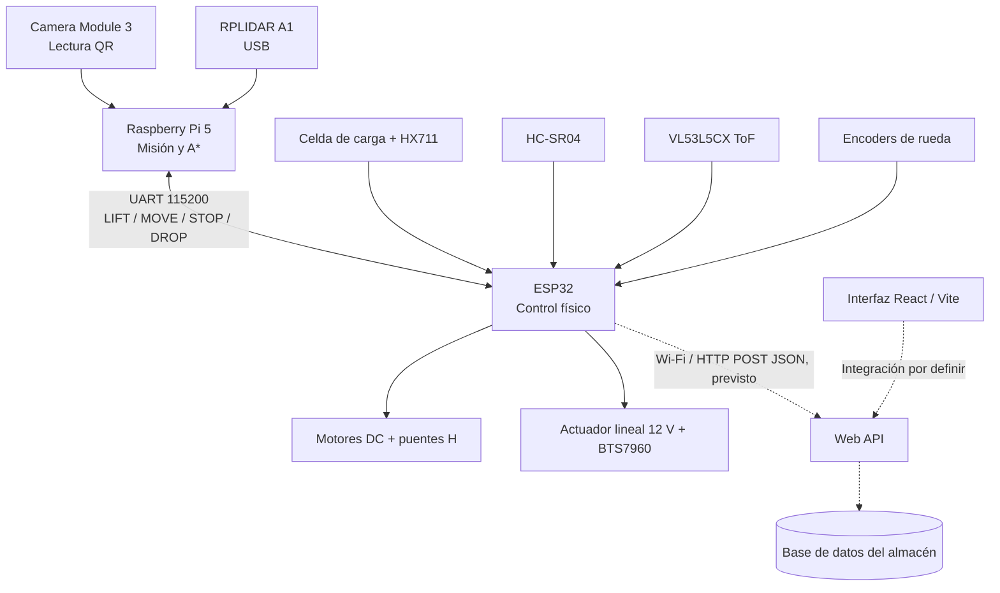
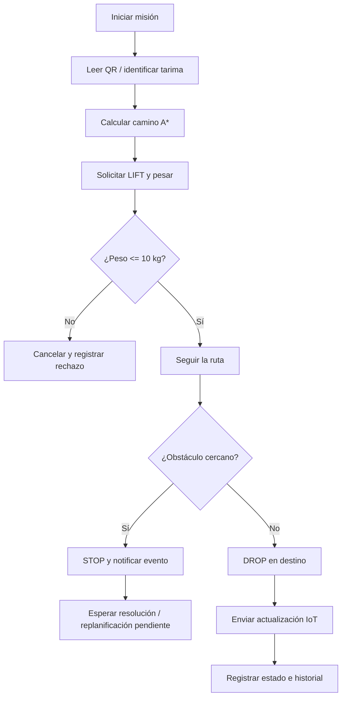
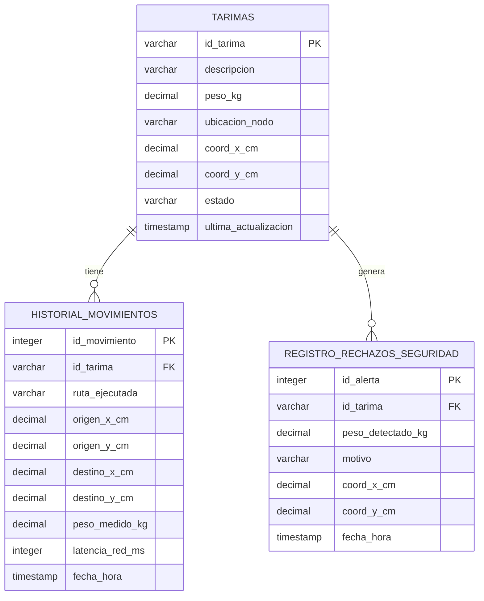

# KOLEO — Documentación general del proyecto

> **Sistema semiautónomo para organización y trazabilidad de tarimas en almacenes**  
> **Área:** Robótica móvil, automatización de almacenes e Internet de las Cosas (IoT)  
> **Contexto académico:** Implementación de Internet de las Cosas, grupo 501 — Tecnológico de Monterrey, Campus Guadalajara  
> **Referencia de estado:** Presentación del equipo del **21 de octubre de 2026** (avances reportados hasta la semana 3).  
> **Tipo de documento:** Especificación y documentación técnica **del proyecto completo**, no de una persona ni de un subsistema aislado.

## Índice

1. [Visión general](#1-visión-general)
2. [Problema, solución y alcance](#2-problema-solución-y-alcance)
3. [Objetivos y criterios cuantitativos](#3-objetivos-y-criterios-cuantitativos)
4. [Arquitectura del sistema](#4-arquitectura-del-sistema)
5. [Diseño mecánico y CAD](#5-diseño-mecánico-y-cad)
6. [Sensores, actuadores y electrónica](#6-sensores-actuadores-y-electrónica)
7. [Software integrado y comunicaciones](#7-software-integrado-y-comunicaciones)
8. [Navegación e identificación de tarimas](#8-navegación-e-identificación-de-tarimas)
9. [Ciclo operativo del sistema](#9-ciclo-operativo-del-sistema)
10. [Datos, persistencia y trazabilidad](#10-datos-persistencia-y-trazabilidad)
11. [Interfaz de operación](#11-interfaz-de-operación)
12. [Seguridad y restricciones](#12-seguridad-y-restricciones)
13. [Indicadores de desempeño](#13-indicadores-de-desempeño)
14. [Estado de desarrollo](#14-estado-de-desarrollo)
15. [Pruebas y validación](#15-pruebas-y-validación)
16. [Brechas técnicas y decisiones por cerrar](#16-brechas-técnicas-y-decisiones-por-cerrar)
17. [Plan de integración](#17-plan-de-integración)
18. [Anexos: fragmentos técnicos de la presentación](#18-anexos-fragmentos-técnicos-de-la-presentación)
19. [Trazabilidad con la presentación](#19-trazabilidad-con-la-presentación)

---

## 1. Visión general

**KOLEO** es una propuesta de robot móvil semiautónomo destinado a transportar tarimas dentro de un almacén y mantener actualizada su ubicación en un sistema digital. El nombre remite a escarabajos blindados capaces de deslizarse bajo cargas.

El proyecto combina una plataforma mecánica de elevación y tracción diferencial con sensores de peso, distancia y visión, una computadora de alto nivel (**Raspberry Pi 5**), un microcontrolador (**ESP32**), comunicación inalámbrica y una base de datos de movimientos. La operación se concibe como una secuencia de **identificar → verificar peso → elevar → planear/recorrer ruta → depositar → registrar movimiento**.

La finalidad no es únicamente mover materiales, sino reducir la discrepancia entre la ubicación física de las tarimas y los registros digitales del almacén, con datos que permitan supervisar tareas, incidentes y desempeño.

**Estado documental:** la presentación describe diseños, fragmentos de firmware, un planeador de rutas, esquema de datos y una propuesta de interfaz. No proporciona evidencia de un robot totalmente integrado y validado en operación real. En este documento se separan **capacidades propuestas**, **trabajo reportado** y **verificaciones pendientes**.

## 2. Problema, solución y alcance

### 2.1 Problema

En almacenes que dependen del movimiento manual de tarimas y de registros que no se actualizan en el momento del traslado, pueden aparecer:

- Pérdida de tiempo y de espacio al ubicar o desplazar cargas.
- Desconocimiento de la posición, contenido o peso de cada tarima.
- Diferencias entre inventario digital y disposición física.
- Retrasos y errores de preparación o envío de pedidos.
- Falta de datos para optimizar rutas y disponibilidad de ubicaciones.

### 2.2 Solución planteada

KOLEO propone una unidad robótica que se sitúa bajo la tarima, evalúa su peso, la levanta mediante un actuador lineal, ejecuta un traslado sobre un mapa del almacén, deposita la carga y reporta información de su nuevo estado. El sistema incluye una interfaz concebida para monitoreo y gestión logística.

### 2.3 Alcance funcional descrito

| Subsistema | Responsabilidad del proyecto |
|---|---|
| Mecánica | Chasis, plataforma portatarima, sistema de elevación y ruedas motrices. |
| Sensado y seguridad | Medición de peso, detección de obstáculos y señales de posición/movimiento. |
| Control de bajo nivel | Accionamiento de motores, actuador y lectura de señales desde el ESP32. |
| Percepción y navegación | Identificación QR, mapa cuadriculado, planeación A* y coordinación de misiones en Raspberry Pi. |
| Conectividad e IoT | UART entre computadoras embebidas y actualización por HTTP/JSON sobre Wi-Fi hacia una API. |
| Persistencia | Estado actual de tarimas, historial de movimientos y rechazos de seguridad. |
| Interfaz | Módulos de flotilla, monitoreo, control y gestión logística. |

**Límite del prototipo documentado:** la capacidad mecánica objetivo es **10 kg**. El material no acredita una capacidad de una tonelada, una navegación robusta en almacenes arbitrarios ni una Web API desplegada y validada.

## 3. Objetivos y criterios cuantitativos

### 3.1 Objetivo general

Diseñar e integrar un prototipo de robot móvil que realice traslados controlados de tarimas de hasta 10 kg en un entorno de almacén de prueba y registre digitalmente los resultados de cada misión.

### 3.2 Objetivos específicos

| ID de referencia¹ | Área | Resultado esperado | Meta de la presentación |
|---|---|---|---|
| OBJ-01 | Mecánica | Elevar una tarima con actuador lineal. | **Hasta 10 kg en menos de 15 s**. |
| OBJ-02 | Navegación | Ir autónomamente de un punto definido a otro. | **Error de llegada menor a 10 cm**. |
| OBJ-03 | Software e IoT | Registrar la nueva ubicación al finalizar el depósito. | **Latencia menor a 2 s** desde que se deposita hasta que se actualiza la base de datos. |
| OBJ-04 | Validación de rutas | Ejecutar rutas predefinidas del mapa de pruebas. | **Tres rutas autónomas**, pendientes de validación física. |
| OBJ-05 | Validación de transporte | Probar operación continua. | **Prueba de traslado de 3 min**, pendiente. |

¹ Los identificadores `OBJ-*` son **etiquetas de organización añadidas en este documento**, no nomenclatura oficial de la presentación.

Las cifras anteriores son **criterios objetivo**, no resultados medidos. La presentación reporta diseños y avances, pero no adjunta series experimentales que demuestren estas metas.

## 4. Arquitectura del sistema

### 4.1 Distribución de responsabilidades

- **Raspberry Pi 5 (8 GB):** coordinación de la misión; lectura del código QR con la cámara; definición de mapa/rutas; planeación A*; intercambio de comandos con el ESP32 mediante UART. El RPLIDAR A1 aparece conectado a la Raspberry Pi por USB.
- **ESP32 DevKit V1:** lectura de la báscula HX711, encoders y sensores de proximidad; control de motores de tracción y del actuador lineal; reporte de errores y eventos; envío HTTP/JSON cuando existe conectividad Wi-Fi.
- **Capa de servidor y datos:** Web API prevista para recibir actualizaciones; base de datos SQLite usada para el diseño/demostración de la presentación; tablas de estado actual, historial y rechazos.
- **Interfaz web:** aplicación propuesta con React, Vite y Tailwind CSS; módulos de administración, monitoreo y control.

### 4.2 Diagrama lógico de integración



Las **líneas punteadas** representan integración prevista o no demostrada completamente en la presentación. El diagrama de aplicación original también representa **Google Coral** como módulo de percepción; su conexión e integración final con la Raspberry Pi no quedan especificadas de manera consistente en las demás láminas y se consideran una decisión de arquitectura abierta.


### 4.3 Comunicación entre subsistemas

| Canal | Participantes | Formato / propósito | Estado documental |
|---|---|---|---|
| UART | Raspberry Pi ↔ ESP32 | Serie a **115200 baudios**, órdenes terminadas en salto de línea. | Protocolo definido en fragmentos; integración física pendiente según el plan. |
| Wi-Fi / HTTP | ESP32 → Web API | `POST` con `Content-Type: application/json`. | Fragmento de envío incluido; programación de API reportada como pendiente. |
| SQL | Servicio/proceso de datos ↔ SQLite | Actualización de tarimas y creación de historial/rechazos. | Demostración con paquetes simulados. |
| Web | Interfaz ↔ datos/control | Consulta de estado y órdenes logísticas. | Módulos y tecnologías definidos; conexión final no documentada. |

## 5. Diseño mecánico y CAD

### 5.1 Configuración física

El prototipo contempla un **chasis móvil con tracción diferencial**, una **plataforma superior para la tarima**, mecanismo de elevación mediante **actuador lineal eléctrico de 12 V**, motores DC con reducción y encoder, elementos de potencia y espacios para sensores y computadoras embebidas.

Las vistas CAD identifican la disposición de cámara/sensor ToF, sensor ultrasónico, RPLIDAR A1, Raspberry Pi 5, ESP32 con puentes H, batería, plataforma y ruedas.

### 5.2 Vistas de diseño

**Vista isométrica:**


**Distribución de componentes:**


**Vista superior:**


**Estado:** se reportan como realizados el CAD 3D, la propuesta del mecanismo de elevación y las vistas de ubicación de componentes. El ensamble del chasis, montaje de tracción y sensores y validación mecánica están listados como pendientes al corte presentado.

## 6. Sensores, actuadores y electrónica

### 6.1 Inventario de componentes principales

| Grupo | Componente | Función documentada |
|---|---|---|
| Visión | Raspberry Pi Camera Module 3 | Leer código QR identificador de tarima. |
| Navegación | RPLIDAR A1 | Percepción espacial y apoyo previsto al mapa. |
| Proximidad | HC-SR04 | Detectar obstáculos cercanos para detener el movimiento. |
| Distancia | VL53L5CX ToF | Medición de distancia por tiempo de vuelo. |
| Peso | Celda de carga + módulo HX711 | Medir carga y restringir elevación por sobrepeso. |
| Procesamiento | Raspberry Pi 5 | Coordinar visión, mapa y ejecución de rutas. |
| Control | ESP32 DevKit V1 | Sensores, motores, actuador, UART y conectividad. |
| Elevación | Actuador lineal eléctrico 12 V + BTS7960 | Levantar y depositar la tarima. |
| Locomoción | Motores DC con reductora, encoders y puentes H | Tracción diferencial y medición de pulsos. |
| Alimentación | Fuente/batería 12 V y reguladores *buck* | Distribuir energía según tensión requerida. |


### 6.2 Pinout del ESP32

**Sensores**

| Dispositivo | Señal | Pin del ESP32 |
|---|---|---|
| HX711 | DT | GPIO 4 |
| HX711 | SCK | GPIO 5 |
| Encoder izquierdo, canal A | Pulsos | GPIO 34 |
| Encoder derecho, canal A | Pulsos | GPIO 35 |
| VL53L5CX (I²C) | SDA | GPIO 21 |
| VL53L5CX (I²C) | SCL | GPIO 22 |
| HC-SR04 | TRIG | GPIO 18 |
| HC-SR04 | ECHO | GPIO 19 |

**Actuación y enlace serie**

| Elemento | Señal | Pin / correspondencia |
|---|---|---|
| BTS7960 (actuador) | RPWM, subir | GPIO 25 |
| BTS7960 (actuador) | LPWM, bajar | GPIO 26 |
| Puente H motor izquierdo | PWM / IN1 / IN2 | GPIO 32 / 33 / 27 |
| Puente H motor derecho | PWM / IN3 / IN4 | GPIO 14 / 12 / 13 |
| Raspberry Pi TXD GPIO14 | ESP32 RX2 | GPIO 16 |
| Raspberry Pi RXD GPIO15 | ESP32 TX2 | GPIO 17 |

**Nota eléctrica de la presentación:** `ECHO` del HC-SR04 trabaja con una señal que requiere **divisor 5 V → 3.3 V** antes de entrar al ESP32. El sistema utiliza tierra común. Los detalles de fuente, cableado y protección deben verificarse físicamente antes de energizar el prototipo.

### 6.3 Conexiones Raspberry Pi 5

| Elemento | Conexión | Detalle |
|---|---|---|
| Camera Module 3 | Puerto CSI | Cable de 22 a 15 pines, según la presentación. |
| RPLIDAR A1 | USB | Datos y alimentación de 5 V por el mismo cable. |
| UART TX | Pin físico 8 / GPIO14 | Conecta a RX2 GPIO16 del ESP32. |
| UART RX | Pin físico 10 / GPIO15 | Conecta a TX2 GPIO17 del ESP32. |
| GND | Pin físico 6 | Referencia compartida con ESP32. |
| Alimentación USB-C | 5 V / 5 A | Desde convertidor *buck* previsto. |

El documento fuente indica habilitar el puerto serie mediante `raspi-config`, usar **115200 baudios**, lógica de **3.3 V** y emplear `Picamera2` para la cámara; un ejemplo de código diferente utiliza OpenCV (`cv2.VideoCapture`). Esta diferencia se conserva como aspecto por integrar.

### 6.4 Distribución de energía documentada

- **12 V:** puentes H de tracción y actuador lineal.
- **Convertidor buck 5 V / 5 A:** Raspberry Pi 5 por USB-C.
- **LM2596:** alimentación regulada para ESP32 y sensores.
- **GND compartida:** referencia de señales entre controladores y módulos.

No aparecen en el material valores medidos de consumo, autonomía, protección de fusibles ni un esquema final de calibre de cableado: estas verificaciones siguen abiertas.

## 7. Software integrado y comunicaciones

### 7.1 Firmware ESP32 (C++)

El firmware presentado contiene cinco responsabilidades:

1. **Arranque:** inicializar UART (`Serial` y `Serial2`), pines, interrupciones de encoders, HX711 y Wi-Fi.
2. **Recepción de órdenes:** interpretar comandos de la Raspberry Pi.
3. **Sensado:** promediar cinco muestras de carga y contabilizar pulsos de cada rueda.
4. **Movimiento:** generar PWM/dirección para dos motores y detener ante un obstáculo detectado.
5. **Depósito e IoT:** descender el actuador, guardar coordenadas y efectuar un `POST` JSON a la API prevista.

### 7.2 Coordinador Raspberry Pi (Python)

El código de alto nivel organiza el mapa cuadriculado, tres rutas de validación, una función de lectura QR, el planeador A* y una función `ejecutar_mision` que manda instrucciones por UART. La lógica de avance mostrada utiliza `MOVE`, una espera fija de **0.8 s** y `STOP` por cada paso. El ajuste para desplazarse **por distancia medida con encoders** está expresamente listado como mejora futura.

### 7.3 Protocolo de órdenes

| Comando / respuesta | Sentido | Semántica presentada |
|---|---|---|
| `LIFT:<id_tarima>` | Pi → ESP32 | Solicitar elevación y verificación del límite de peso. |
| `ACK:LIFT_OK` | ESP32 → Pi | Confirmación de elevación exitosa. |
| `ERR:OVERWEIGHT` | ESP32 → Pi | Cancelar misión por sobrepeso. |
| `MOVE:<pwm_izq>:<pwm_der>` | Pi → ESP32 | Ordenar velocidades/sentidos de ambas ruedas. |
| `STOP` | Pi → ESP32 | Detener tracción. |
| `ERR:OBSTACULO_CERCANO` | ESP32 → Pi | Notificar parada por proximidad. |
| `DROP:<id_tarima>:<x_cm>:<y_cm>` | Pi → ESP32 | Depositar tarima y actualizar su ubicación. |

Los fragmentos del `loop()` en ESP32 **no muestran el tratamiento de `DROP`**, aunque existe una función de depósito en otra lámina. Se necesita incorporar y validar la ruta de extremo a extremo antes de considerarla operativa.

### 7.4 Mensaje IoT esperado

La presentación menciona los campos del reporte de actualización, sin incluir un contrato formal de API ni un cuerpo completo. El ejemplo siguiente es **ilustrativo de la estructura**, no una captura de un mensaje verificado:

```json
{
  "id_tarima": "TAR-101",
  "peso_kg": 8.45,
  "coord_x_cm": 150.0,
  "coord_y_cm": 120.0,
  "estado": "EN_PISO"
}
```

La **URL, autenticación, códigos HTTP, reintentos, idempotencia y almacenamiento offline** no quedan definidos en las diapositivas.

## 8. Navegación e identificación de tarimas

### 8.1 Mapa de validación

El entorno de prueba del código es una matriz de **5 filas × 6 columnas**, con celdas de **30 × 30 cm**. Una celda `0` representa espacio libre y `1` representa obstáculo o estantería.

```text
0 0 0 1 0 0
0 1 0 1 0 0
0 1 0 0 0 1
0 0 0 1 0 0
1 1 0 0 0 0
```

### 8.2 Rutas registradas en el ejemplo

| Ruta | Inicio (fila, columna) | Meta (fila, columna) | Tarima asignada |
|---|---|---|---|
| RUTA_1 | `(0, 0)` | `(4, 5)` | `TAR-101` |
| RUTA_2 | `(0, 2)` | `(3, 4)` | `TAR-102` |
| RUTA_3 | `(4, 2)` | `(0, 5)` | `TAR-103` |

En el código, la posición de destino se convierte a coordenadas de centímetros mediante `x = columna × 30` y `y = fila × 30`.

### 8.3 Planeación A*

El planeador utiliza **distancia Manhattan** como heurística, una cola de prioridad (`heapq`), expansión a cuatro vecinos (arriba, abajo, izquierda y derecha) y reconstrucción de camino a partir de la relación de predecesores.

### 8.4 Identificación visual

La función QR intenta decodificar durante **2.5 s**. Si no hay lectura, utiliza el identificador predeterminado de la ruta. Para una demostración es un mecanismo de respaldo; en operación real, utilizar un ID por defecto sin verificación puede asociar una carga equivocada al traslado, por lo que la política de aceptación de identificación queda por definir.

### 8.5 Localización y navegación física

La presentación combina **un planeador sobre cuadrícula** con sensores de proximidad y un **RPLIDAR A1** aún pendiente de integrar al mapa. No se demuestra localización SLAM, estimación final de posición con encoders ni control cerrado para alcanzar la tolerancia de error **menor a 10 cm**. La autonomía física completa queda sujeta a esas integraciones y pruebas.

## 9. Ciclo operativo del sistema

### 9.1 Secuencia funcional prevista

1. **Seleccionar una misión** y sus coordenadas de origen/destino.
2. **Identificar la tarima** por QR o, en la demostración, por el ID de respaldo de la ruta.
3. **Calcular una ruta** con A* a partir del mapa del almacén.
4. **Solicitar elevación** (`LIFT`) al ESP32.
5. **Verificar el peso:** permitir la misión dentro del límite de 10 kg o rechazarla por sobrepeso.
6. **Avanzar por la ruta** mediante comandos a los motores; detener por proximidad cuando aplique.
7. **Depositar** la tarima mediante `DROP` y retraer el mecanismo.
8. **Publicar los datos** del traslado y actualizar el estado de la tarima en la base.
9. **Exponer resultados** en registros y, cuando se conecte la interfaz, en los módulos de monitoreo y gestión.



El diagrama anterior integra el **comportamiento esperado** del sistema. La gestión posterior a un obstáculo, replanificación automática y confirmación de persistencia **no aparecen implementadas completamente** en los fragmentos disponibles.

### 9.2 Estados de negocio mencionados

- `EN_PISO`: reporte del ESP32 al finalizar el depósito.
- `UBICADA_DESTINO`: valor usado por la demostración de actualización de base de datos.
- `BLOQUEADA_SOBREPESO`: rechazo registrado cuando la carga excede 10 kg.

Estos valores aparecen en distintos módulos. **No existe una enumeración de estados unificada** en la presentación; debe definirse antes de integrar firmware, API, base de datos e interfaz.

## 10. Datos, persistencia y trazabilidad

### 10.1 Modelo de información

La presentación propone una base `koleo_almacen`, modelada con tres tablas relacionadas por `id_tarima`:

- `tarimas`: una fila por tarima, con su peso, coordenadas, ubicación, estado y última actualización.
- `historial_movimientos`: una fila por traslado, con ruta, origen, destino, peso, latencia y fecha.
- `registro_rechazos_seguridad`: una fila por rechazo de carga, con motivo, peso detectado, coordenadas y fecha.




### 10.2 Diccionario de entidades

**`tarimas`**

| Campo | Tipo mostrado | Función |
|---|---|---|
| `id_tarima` | VARCHAR(32), PK | Identificador de la carga. |
| `descripcion` | VARCHAR(100) | Información del contenido. |
| `peso_kg` | DECIMAL(5,2) | Peso registrado. |
| `ubicacion_nodo` | VARCHAR(16) | Ubicación lógica en el almacén. |
| `coord_x_cm` / `coord_y_cm` | DECIMAL(6,2) | Posición espacial. |
| `estado` | VARCHAR(20) | Estado operativo/logístico. |
| `ultima_actualizacion` | TIMESTAMP | Fecha del último reporte. |

**`historial_movimientos`**

| Campo | Tipo mostrado | Función |
|---|---|---|
| `id_movimiento` | INTEGER, PK | Identificador de evento. |
| `id_tarima` | VARCHAR(32), FK | Tarima relacionada. |
| `ruta_ejecutada` | VARCHAR(32) | Trayecto realizado. |
| `origen_x_cm` / `origen_y_cm` | DECIMAL(6,2) | Coordenadas de partida. |
| `destino_x_cm` / `destino_y_cm` | DECIMAL(6,2) | Coordenadas de llegada. |
| `peso_medido_kg` | DECIMAL(5,2) | Peso observado. |
| `latencia_red_ms` | INTEGER | Métrica prevista del registro. |
| `fecha_hora` | TIMESTAMP | Instante del movimiento. |

**`registro_rechazos_seguridad`**

| Campo | Tipo mostrado | Función |
|---|---|---|
| `id_alerta` | INTEGER, PK | Identificador de rechazo. |
| `id_tarima` | VARCHAR(32), FK | Tarima rechazada. |
| `peso_detectado_kg` | DECIMAL(5,2) | Peso que originó la alarma. |
| `motivo` | VARCHAR(100) | Justificación del rechazo. |
| `coord_x_cm` / `coord_y_cm` | DECIMAL(6,2) | Posición del incidente. |
| `fecha_hora` | TIMESTAMP | Marca temporal. |

### 10.3 Datos de demostración

| ID | Descripción | Peso | Comportamiento esperado |
|---|---|---:|---|
| `TAR-101` | Lote Electrónica A | 8.45 kg | Traslado válido de la ruta 1. |
| `TAR-102` | Baterías (Sobrepeso) | 11.80 kg | Rechazo por superar el límite. |
| `TAR-103` | Sensores Ópticos C | 6.20 kg | Traslado válido de la ruta 3. |

La simulación invoca `procesar_paquete_esp32(...)` y consulta antes/después el estado del almacén. Es **una demostración de software**, no una prueba física de navegación con carga.

### 10.4 Integridad de datos pendiente

El material presenta diferencias entre las columnas del modelo entidad-relación y las del código SQL de demostración: `ruta_ejecutada` frente a `ruta`, `peso_medido_kg` frente a `peso_kg`, y `latencia_red_ms` frente a `latencia_ms`. Además, el fragmento `CREATE TABLE tarimas` omite `ubicacion_nodo`. Estas diferencias deben resolverse en un esquema canónico antes de conectar la API.

## 11. Interfaz de operación

**Tecnologías propuestas:** React, Vite y Tailwind CSS.

| Módulo | Información o acciones previstas |
|---|---|
| **Flotilla** | Robots disponibles, identificador, conexión, estado y alertas. |
| **Monitoreo** | Peso/capacidad, velocidad, ruta e historial. |
| **Control** | Iniciar o cancelar rutas, seleccionar destinos y controlar movimientos autorizados. |
| **Gestión logística** | Registrar tarimas, consultar ubicaciones, asignar rutas y revisar traslados concluidos. |

La presentación describe **la organización funcional de la interfaz**, pero no aporta un contrato de integración con el servicio ni capturas verificables del funcionamiento final del tablero. La capa de interfaz debe consumir el mismo modelo de estados, ubicaciones e incidencias que la base de datos.

## 12. Seguridad y restricciones

| Riesgo | Control o consideración expresada en el material | Verificación pendiente |
|---|---|---|
| Sobrepeso | Límite de **10 kg**, respuesta `ERR:OVERWEIGHT` y registro de rechazo. | Pruebas reales con pesos a ambos lados del umbral. |
| Obstáculos cercanos | HC-SR04, parada de motores y aviso `ERR:OBSTACULO_CERCANO`. | Determinar/calibrar el umbral `DISTANCIA_PARO_CM` y medir la respuesta. |
| Fallo de báscula | Se planea bloquear elevación si falla el HX711. | Aplicar política de fallo seguro: el fragmento devuelve `0.0` si no hay lectura. |
| Desajuste de posición | Meta de error menor a 10 cm. | Integrar encoders y sensado para estimación/corrección de avance. |
| Pérdida de comunicación | UART y Wi-Fi están previstos. | Definir expiraciones, confirmación de comandos y recuperación. |
| Alimentación | 12 V con regulación 5 V y señales lógicas a 3.3 V. | Comprobar consumos, cableado, protección y continuidad de tierra. |
| Trazabilidad | Registros de movimientos, estados y rechazos. | Confirmar inserciones consistentes y asociación correcta de IDs QR. |

**Precisión importante:** el bloque de detección de obstáculos mostrado evalúa proximidad al recibir un comando `MOVE`. La presentación enumera como mejora el **freno continuo por obstáculo**; por tanto, no debe describirse como demostrado un monitoreo permanente independiente del bucle de comandos.

## 13. Indicadores de desempeño

La presentación propone observar los siguientes indicadores:

| Indicador | Qué permite conocer | Estado / umbral disponible |
|---|---|---|
| Ocupación y disponibilidad en tiempo real | Distribución de espacios y tarimas. | Sin fórmula ni meta de referencia. |
| Posición actual del robot | Localización durante la misión. | Sin precisión medida reportada. |
| Tiempo de ciclo por tarima | Duración de un traslado. | Sin objetivo global; prueba de 3 min planeada. |
| Peso de carga | Cumplimiento del límite mecánico. | Máximo **10 kg**. |
| Precisión de posicionamiento | Desvío frente al punto final previsto. | Meta **< 10 cm**. |
| Eficiencia de ruta | Calidad del trayecto seguido. | Sin fórmula fijada. |
| Distancia mínima a obstáculos | Margen espacial durante traslado. | Sin umbral numérico reportado. |
| Alertas e incidencias | Fallas, rechazos y eventos de seguridad. | Se contemplan eventos de sobrepeso y obstáculos. |
| Latencia de actualización | Tiempo entre depósito y persistencia. | Meta **< 2 s**. |

En el fragmento de base de datos, `time.perf_counter()` mide duración local del procesamiento del paquete. **Eso no acredita por sí solo** la latencia completa entre el depósito físico y la actualización visible en la base; esa métrica requiere instrumentación de extremo a extremo.

## 14. Estado de desarrollo

### 14.1 Avances reportados hasta la semana 3

| Área | Evidencia o entregable descrito |
|---|---|
| Mecánica | CAD del chasis y mecanismo de elevación, con vistas de componentes. |
| Hardware | Lista de componentes/potencia, conexiones ESP32/Pi y propuesta de alimentación. |
| Navegación y visión | Planeador A* para tres rutas definidas, lectura QR y protocolo serial de misión. |
| Firmware e IoT | Fragmentos de control, pesaje, límite de 10 kg y publicación HTTP/JSON. |
| Datos e interfaz | Diseño de tres tablas, simulación SQLite y distribución funcional del tablero. |

### 14.2 Trabajo pendiente consignado en la presentación

- Ensamblar el chasis y el sistema de elevación.
- Instalar tracción, celda de carga y demás sensores.
- Implementar la Web API de recepción.
- Conectar y validar la comunicación UART real entre Raspberry Pi y ESP32.
- Desplazarse por distancia con encoders en vez de depender de tiempos fijos.
- Habilitar parada continua por obstáculos.
- Impedir elevación ante un fallo del sistema de pesaje.
- Integrar RPLIDAR al mapa y cámara mediante `Picamera2`.
- Ejecutar pruebas de 10 kg, 3 minutos, tres rutas y latencia menor a 2 segundos.

Los avances son **reportados por las diapositivas**, no certificados mediante evidencia externa, videos de pruebas o mediciones adjuntas.

## 15. Pruebas y validación

Los casos siguientes formalizan las pruebas **planeadas** a partir de los objetivos; la presentación no muestra sus resultados completos.

| Caso | Condición | Criterio de aceptación | Evidencia que faltaría generar |
|---|---|---|---|
| VAL-01 | Tarima ≤ 10 kg | Levantar hasta 10 kg en **< 15 s**. | Masa calibrada, cronometraje y video/sensor. |
| VAL-02 | Tarima > 10 kg | Rechazar elevación y registrar alerta. | Respuesta UART, estado de actuador y fila SQL. |
| VAL-03 | Rutas RUTA_1, RUTA_2 y RUTA_3 | Completar tres recorridos planeados sin colisión. | Bitácora de ejecución y trayectorias. |
| VAL-04 | Llegada a destino | Error final **< 10 cm**. | Medición física de coordenadas objetivo y reales. |
| VAL-05 | Obstáculo en trayectoria | Detener tracción y notificar el incidente. | Distancia registrada, señal de motor y tiempo de respuesta. |
| VAL-06 | Traslado sostenido | Superar la prueba de transporte de **3 min**. | Registro temporal y estabilidad de energía/control. |
| VAL-07 | Depósito y actualización | Nueva posición persistida en **< 2 s**. | Timestamps comparables extremo a extremo. |
| VAL-08 | Paquetes de ejemplo | Guardar dos traslados válidos y un rechazo por 11.80 kg. | Consulta SQL y tablas actualizadas. |

`VAL-*` son identificadores incorporados para facilitar el seguimiento y **no implican que las pruebas ya hayan sido aprobadas**.

## 16. Brechas técnicas y decisiones por cerrar

1. **API no especificada:** no se documentan endpoints completos, validación de datos, autenticación ni contrato de errores.
2. **Protocolo UART incompleto:** falta mostrar el tratamiento `DROP` en el `loop()` y acordar confirmación/timeout de cada transición.
3. **Control de movimiento abierto:** el ejemplo utiliza tiempo fijo por celda y no calcula la trayectoria física a partir de encoders; la tolerancia de 10 cm requiere más integración.
4. **Seguridad del HX711:** una lectura no disponible devuelve `0.0` en el código mostrado; el requisito de bloquear elevación ante fallo está pendiente.
5. **Ambigüedad de percepción:** se cita Google Coral en un diagrama y RPLIDAR/cámara conectados a Raspberry Pi en las láminas de hardware; falta fijar el diseño final.
6. **Modelo SQL no homologado:** los nombres de columnas y algunos campos difieren entre ERD y código.
7. **Estados de sistema distintos:** `EN_PISO` y `UBICADA_DESTINO` se utilizan en módulos separados sin contrato común.
8. **Evidencia de rendimiento ausente:** los umbrales cuantitativos son metas, no mediciones verificadas.
9. **Conexión interfaz-servidor:** existen módulos propuestos, pero no se documentan APIs ni autorización de acciones.
10. **Persistencia al interrumpirse Wi-Fi:** no se define tratamiento de fallos o reintentos para evitar movimientos no reflejados en la base.

## 17. Plan de integración

La siguiente **secuencia propuesta para integrar el proyecto** se deriva de las tareas pendientes, sin atribuir fechas o entregables cumplidos que no consten en la presentación:

| Etapa | Trabajo prioritario | Condición para continuar |
|---|---|---|
| 1. Consolidación | Homologar conexiones, comandos, estados y esquema SQL. | Interfaces hardware/software documentadas sin contradicciones. |
| 2. Ensamble | Integrar chasis, elevador, motores, sensores y alimentación. | Pruebas básicas de accionamiento y lectura fiables. |
| 3. Seguridad | Validar sobrepeso, parada por proximidad y manejo de fallos. | El robot entra en estado seguro frente a casos críticos. |
| 4. Navegación | Conectar Pi y ESP32; usar encoders y percepción en el recorrido. | Ejecutar rutas sin recurrir únicamente a tiempos fijos. |
| 5. Persistencia | Implementar API, persistir movimiento y errores, probar reconexión. | Registros completos y coherentes tras cada misión. |
| 6. Interfaz | Integrar flotilla, monitoreo, control y logística. | Datos y órdenes coinciden con estado real del sistema. |
| 7. Validación | Ejecutar batería VAL-01 a VAL-08 y documentar resultados. | Evidencia reproducible sobre objetivos de la presentación. |

---

## 18. Anexos: fragmentos técnicos de la presentación

Los fragmentos de esta sección se **conservan como material de referencia**, no como repositorio completo y ejecutable. Algunas constantes, funciones auxiliares, sentencias y tablas aparecen abreviadas en las diapositivas; los ejemplos de control, navegación, API y SQLite no constituyen una implementación integrada validada.

### A.1 Firmware ESP32 — inicialización

```cpp
#include <WiFi.h>
#include <HTTPClient.h>
#include "HX711.h"

void setup() {
    Serial.begin(115200);
    Serial2.begin(115200, SERIAL_8N1, 16, 17);

    // Configuración de pines
    pinMode(PIN_ACT_SUBIR, OUTPUT);
    pinMode(PIN_ACT_BAJAR, OUTPUT);
    // ... otros pines del firmware

    // Interrupciones para encoders
    pinMode(PIN_ENC_L, INPUT_PULLUP);
    pinMode(PIN_ENC_R, INPUT_PULLUP);
    attachInterrupt(digitalPinToInterrupt(PIN_ENC_L),
                    isrEncoderIzq, RISING);
    attachInterrupt(digitalPinToInterrupt(PIN_ENC_R),
                    isrEncoderDer, RISING);

    // Inicialización del HX711
    balanza.begin(PIN_HX711_DT, PIN_HX711_SCK);
    balanza.set_scale(FACTOR_CALIBRACION);
    balanza.tare();

    // Conexión a Wi-Fi
    WiFi.begin(WIFI_SSID, WIFI_PASSWORD);
}
```


### A.2 Firmware ESP32 — recepción UART

```cpp
void loop() {
    if (Serial2.available()) {
        String comando = Serial2.readStringUntil('\n');
        comando.trim();

        if (comando.startsWith("LIFT:")) {
            idTarimaActual = comando.substring(5);
            bool exito = levantarTarima(idTarimaActual);

            Serial2.println(exito ?
                "ACK:LIFT_OK" : "ERR:OVERWEIGHT");
        }
        else if (comando.startsWith("MOVE:")) {
            int p1 = comando.indexOf(':', 5);
            int velL = comando.substring(5, p1).toInt();
            int velR = comando.substring(p1 + 1).toInt();

            moverMotores(velL, velR);
        }
        else if (comando == "STOP") {
            detenerMotores();
        }
    }
}
```


### A.3 Firmware ESP32 — peso y encoders

```cpp
// Peso: celda de carga con HX711
float medirPesoKg() {
    if (balanza.is_ready()) {
        float peso = balanza.get_units(5);
        return (peso < 0.0) ? 0.0 : peso;
    }
    return 0.0;
}

// Encoders: contadores de pulsos
volatile long pulsosEncoderIzq = 0;
volatile long pulsosEncoderDer = 0;

void IRAM_ATTR isrEncoderIzq() {
    pulsosEncoderIzq++;
}

void IRAM_ATTR isrEncoderDer() {
    pulsosEncoderDer++;
}

// Se activan desde setup() con RISING
```


### A.4 Firmware ESP32 — control de tracción

```cpp
void moverMotores(int pwmIzq, int pwmDer) {
    if (medirDistanciaUltrasonicoCm() <
        DISTANCIA_PARO_CM &&
        (pwmIzq > 0 || pwmDer > 0)) {
        detenerMotores();
        Serial2.println("ERR:OBSTACULO_CERCANO");
        return;
    }

    digitalWrite(PIN_MOT_L_IN1, pwmIzq >= 0 ? HIGH : LOW);
    digitalWrite(PIN_MOT_L_IN2, pwmIzq >= 0 ? LOW : HIGH);
    analogWrite(PIN_MOT_L_PWM, abs(pwmIzq));

    digitalWrite(PIN_MOT_R_IN3, pwmDer >= 0 ? HIGH : LOW);
    digitalWrite(PIN_MOT_R_IN4, pwmDer >= 0 ? LOW : HIGH);
    analogWrite(PIN_MOT_R_PWM, abs(pwmDer));
}

void detenerMotores() {
    analogWrite(PIN_MOT_L_PWM, 0);
    analogWrite(PIN_MOT_R_PWM, 0);
}
```


### A.5 Firmware ESP32 — depósito y reporte

```cpp
void depositarTarima(String idTarima,
                     float nuevoX, float nuevoY) {
    Serial.println("Descendiendo actuador...");
    analogWrite(PIN_ACT_SUBIR, 0);
    analogWrite(PIN_ACT_BAJAR, 255);
    delay(TIEMPO_ELEV_MS);
    analogWrite(PIN_ACT_BAJAR, 0);

    coordX_cm = nuevoX;
    coordY_cm = nuevoY;

    float pesoFinal = medirPesoKg();
    enviarActualizacionBD(idTarima, pesoFinal,
        coordX_cm, coordY_cm, "EN_PISO");
}
```

```cpp
// Envío a la base de datos
if (WiFi.status() == WL_CONNECTED) {
    HTTPClient http;
    http.begin(SERVER_URL);
    http.addHeader("Content-Type", "application/json");
    // payload: JSON armado previamente
    int resultado = http.POST(payload);
    http.end();
}
```


### A.6 Raspberry Pi — mapa y rutas

```python
import heapq
import time
import serial
import cv2

# Mapa del almacén: celdas de 30 x 30 cm
# 0 = pasillo libre, 1 = estantería / obstáculo
MAPA_ALMACEN = [
    [0, 0, 0, 1, 0, 0],
    [0, 1, 0, 1, 0, 0],
    [0, 1, 0, 0, 0, 1],
    [0, 0, 0, 1, 0, 0],
    [1, 1, 0, 0, 0, 0]
]

# Las 3 rutas oficiales de validación (Hito 2)
RUTAS_VALIDACION = {
    "RUTA_1": {"inicio": (0, 0), "fin": (4, 5),
               "tarima_default": "TAR-101"},
    "RUTA_2": {"inicio": (0, 2), "fin": (3, 4),
               "tarima_default": "TAR-102"},
    "RUTA_3": {"inicio": (4, 2), "fin": (0, 5),
               "tarima_default": "TAR-103"},
}
```


### A.7 Raspberry Pi — lectura QR

```python
def leer_qr_tarima(id_respaldo="TAR-101"):
    cap = cv2.VideoCapture(0)
    detector = cv2.QRCodeDetector()
    t_inicio = time.time()

    while time.time() - t_inicio < 2.5:
        ret, frame = cap.read()
        if not ret:
            break
        datos, _, _ = detector.detectAndDecode(frame)
        if datos:
            cap.release()
            print(f"[CÁMARA RGB] Tarima: {datos}")
            return datos

    cap.release()
    # Sin QR: usa el ID asignado a la ruta
    return id_respaldo
```


### A.8 Raspberry Pi — planeación A*

```python
class PlanificadorAStar:
    @staticmethod
    def heuristica(a, b):
        return abs(a[0] - b[0]) + abs(a[1] - b[1])

    @classmethod
    def calcular_ruta(cls, mapa, inicio, meta):
        filas, cols = len(mapa), len(mapa[0])
        frontera = [(0, inicio)]
        vino_de = {inicio: None}
        costo_g = {inicio: 0}

        while frontera:
            _, actual = heapq.heappop(frontera)
            if actual == meta:
                break

            for df, dc in [(-1, 0), (1, 0), (0, -1), (0, 1)]:
                vecino = (actual[0] + df, actual[1] + dc)
                if 0 <= vecino[0] < filas and 0 <= vecino[1] < cols:
                    if mapa[vecino[0]][vecino[1]] == 1:
                        continue  # obstáculo
                    nuevo_costo = costo_g[actual] + 1
                    if vecino not in costo_g or nuevo_costo < costo_g[vecino]:
                        costo_g[vecino] = nuevo_costo
                        prioridad = nuevo_costo + cls.heuristica(vecino, meta)
                        heapq.heappush(frontera, (prioridad, vecino))
                        vino_de[vecino] = actual

        if meta not in vino_de:
            return []

        ruta, paso = [], meta
        while paso is not None:
            ruta.append(paso)
            paso = vino_de[paso]
        ruta.reverse()
        return ruta
```


### A.9 Raspberry Pi — ejecución de misión

```python
def ejecutar_mision(nombre_ruta, puerto_serial=None):
    config = RUTAS_VALIDACION[nombre_ruta]
    inicio, meta = config["inicio"], config["fin"]

    # 1. Identificar la tarima
    id_tarima = leer_qr_tarima(config["tarima_default"])

    # 2. Calcular la ruta con A*
    ruta = PlanificadorAStar.calcular_ruta(
        MAPA_ALMACEN, inicio, meta)

    # 3. Levantar y pesar la tarima
    if puerto_serial:
        puerto_serial.write(f"LIFT:{id_tarima}\n".encode())
        respuesta = puerto_serial.readline().decode().strip()
        if respuesta == "ERR:OVERWEIGHT":
            return  # excede 10 kg: se cancela

    # 4. Recorrer la ruta (cada celda = 30 cm)
    for paso in ruta[1:]:
        if puerto_serial:
            puerto_serial.write(b"MOVE:180:180\n")
            time.sleep(0.8)
            puerto_serial.write(b"STOP\n")

    # 5. Depositar y actualizar la base de datos
    dest_x, dest_y = meta[1] * 30.0, meta[0] * 30.0
    if puerto_serial:
        puerto_serial.write(
            f"DROP:{id_tarima}:{dest_x}:{dest_y}\n".encode())

if __name__ == "__main__":
    ejecutar_mision("RUTA_1", puerto_serial=None)
    # ... igual con RUTA_2 y RUTA_3
```


### A.10 SQLite — inicialización de datos de demostración

```python
import sqlite3
import time
from datetime import datetime

def inicializar_bd():
    conn = sqlite3.connect("koleo_almacen.db")
    cursor = conn.cursor()
    cursor.executescript("""
        DROP TABLE IF EXISTS tarimas;
        -- (igual con las otras dos tablas)
        CREATE TABLE tarimas (
            id_tarima TEXT PRIMARY KEY,
            descripcion TEXT, peso_kg REAL,
            coord_x_cm REAL, coord_y_cm REAL,
            estado TEXT, ultima_actualizacion TEXT);
        -- + historial_movimientos
        -- + registro_rechazos_seguridad
        INSERT INTO tarimas VALUES
        ('TAR-101', 'Lote Electrónica A', 8.45, ...),
        ('TAR-102', 'Baterías (Sobrepeso)', 11.80, ...),
        ('TAR-103', 'Sensores Ópticos C', 6.20, ...);
    """)
    conn.commit()
    return conn
```


### A.11 SQLite — registrar un paquete

```python
def procesar_paquete_esp32(conn, id_tarima, peso_kg,
                           ruta, nuevo_x, nuevo_y):
    t_inicio = time.perf_counter()
    cursor = conn.cursor()
    ahora = datetime.now().strftime("%Y-%m-%d %H:%M:%S")

    # Seguridad: rechazar si supera 10 kg
    if peso_kg > 10.0:
        cursor.execute("UPDATE tarimas SET "
            "estado='BLOQUEADA_SOBREPESO', "
            "ultima_actualizacion=? WHERE id_tarima=?",
            (ahora, id_tarima))
        cursor.execute("INSERT INTO registro_rechazos_seguridad "
            "(id_tarima, peso_detectado_kg, motivo, fecha_hora) "
            "VALUES (?, ?, ?, ?)", (id_tarima, peso_kg,
            "EXCEDE_LIMITE_10KG_ACTUADOR_PROTEGIDO", ahora))
        conn.commit()
        return

    # Carga válida: actualizar peso y coordenadas
    cursor.execute("UPDATE tarimas SET peso_kg=?, "
        "coord_x_cm=?, coord_y_cm=?, estado='UBICADA_DESTINO', "
        "ultima_actualizacion=? WHERE id_tarima=?",
        (peso_kg, nuevo_x, nuevo_y, ahora, id_tarima))
    latencia_ms = (time.perf_counter() - t_inicio) * 1000

    # Registrar el movimiento en el historial
    cursor.execute("INSERT INTO historial_movimientos "
        "(id_tarima, ruta, destino_x_cm, destino_y_cm, "
        "peso_kg, latencia_ms, fecha_hora) "
        "VALUES (?, ?, ?, ?, ?, ?, ?)", (id_tarima, ruta,
        nuevo_x, nuevo_y, peso_kg, round(latencia_ms, 2), ahora))
    conn.commit()
```


### A.12 SQLite — consulta y simulación

```python
def mostrar_estado_bodega(conn):
    cursor = conn.cursor()
    for fila in cursor.execute(
        "SELECT id_tarima, peso_kg, coord_x_cm, coord_y_cm, "
        "estado, ultima_actualizacion FROM tarimas"):
        coord = f"({fila[2]:.0f}, {fila[3]:.0f}) cm"
        print(f"{fila[0]:<10} | {fila[1]:<10.2f} | "
              f"{coord:<16} | {fila[4]:<22} | {fila[5]}")

if __name__ == "__main__":
    conexion = inicializar_bd()
    mostrar_estado_bodega(conexion)

    # Paquetes que mandaría el ESP32
    time.sleep(1)
    procesar_paquete_esp32(conexion, "TAR-101", 8.45,
                           "RUTA_1", 150.0, 120.0)
    time.sleep(1)
    procesar_paquete_esp32(conexion, "TAR-102", 11.80,
                           "RUTA_2", 90.0, 120.0)  # > 10 kg
    time.sleep(1)
    procesar_paquete_esp32(conexion, "TAR-103", 6.20,
                           "RUTA_3", 150.0, 0.0)

    mostrar_estado_bodega(conexion)
    conexion.close()
```

---

## 19. Trazabilidad con la presentación

| Secciones de este documento | Diapositivas de referencia |
|---|---|
| Visión, problemática y objetivos | 1–3 |
| Sensores, arquitectura e indicadores | 4–6 |
| CAD del robot | 8–10 |
| Conexiones y alimentación | 11–12 |
| Estado y pendientes | 13–14 |
| Firmware ESP32 | 15–20 |
| Software Raspberry Pi | 21–25 |
| Modelo y demostración SQLite | 26–30 |
| Interfaz web | 31–32 |

**Fuente de la documentación:** *Organización automática en almacenes*, presentación KOLEO, Tecnológico de Monterrey, 21 de octubre de 2026, 32 diapositivas. Este documento reestructura los contenidos desde una **perspectiva integral del proyecto**, sin atribuir las secciones a personas concretas.

**Convención de fidelidad:** las descripciones de componentes, metas, rutas, pines y ejemplos de código se basan en las diapositivas. La estructuración en requerimientos, casos de prueba, brechas y etapas de integración es una síntesis documental; no representa evidencia de funcionalidades ya validadas.
