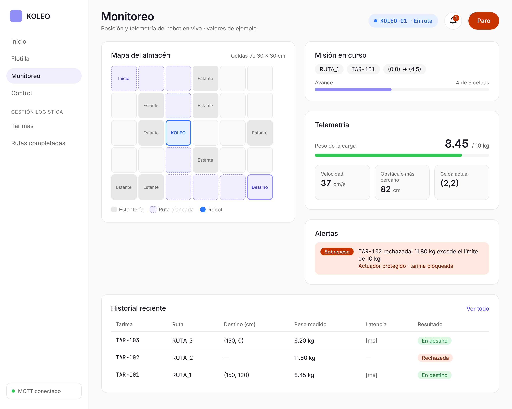
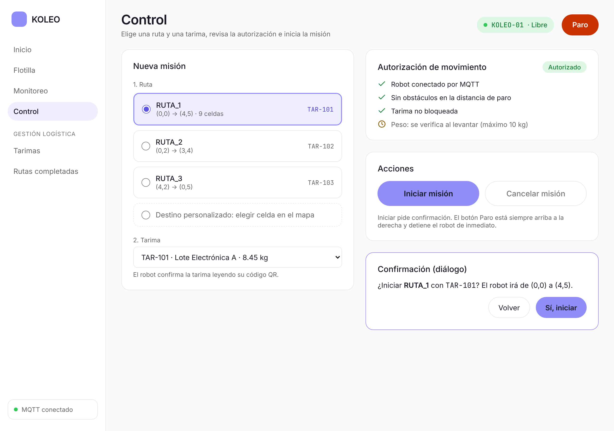
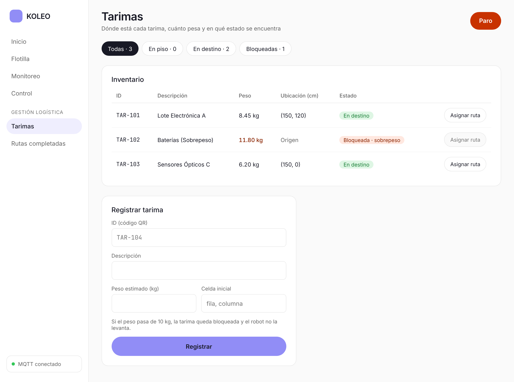

# Wireframes de la interfaz

Estilo visual: **Visitors** de [Refero](https://styles.refero.design/style/e7876363-181a-44a9-9e5c-2255cf98aea5) (claro y plano). Acción en lavanda `#918df6`, estados en verde `#33c758` y ámbar `#ffa600`, y rojo para Paro y sobrepeso. Tipografía Inter, con JetBrains Mono para IDs como `TAR-101`.

Los datos son de ejemplo: TAR-101 a TAR-103 y RUTA_1 a RUTA_3 vienen de la documentación. La velocidad y la distancia al obstáculo son inventadas, y la latencia aparece como `[ms]` porque aún no se mide.

Cada pantalla está como imagen (`.png`) y como HTML estático (`.html`, ábrelo en el navegador; los enlaces del menú lateral llevan de una a otra).

## Monitoreo

Posición del robot en el mapa, misión en curso, telemetría, alertas e historial reciente.

## Control

Elegir ruta y tarima, revisar la autorización de movimiento e iniciar, cancelar o detener (Paro) la misión.

## Gestión logística · Tarimas

Inventario de tarimas con peso, ubicación y estado, y formulario para registrar una nueva.

## Pendientes

Faltan Inicio, Flotilla y Rutas completadas; se harán cuando se aprueben estas tres.
